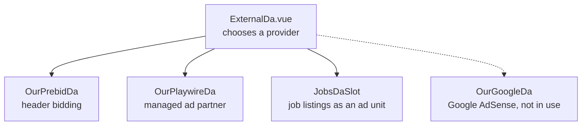

# Adverts

Freegle is free to use and free to join. It costs money to run. Adverts are one of the two
ways that money arrives, the other being [donations](donations-and-gift-aid.md). The two
are wired together, which is the most important thing on this page.

## Ads switch themselves off when members donate

A scheduled job, `donations:update-ads-target`
(`iznik-batch/app/Console/Commands/Donation/UpdateAdsTargetCommand.php`), compares
donations received in the last 24 hours against a target held in the `config` table
(`ads_off_target_max`). It writes back two values:

| Config key | Meaning |
|---|---|
| `ads_off_target` | How much is still needed today |
| `ads_enabled` | `0` once today's target is met, `1` otherwise |

So on a good day the site shows no adverts at all. When you are looking at production and
see no ads, that is very often the reason, not a bug. Check the `config` table before
debugging an ad provider.

## The component layout

Everything goes through one dispatcher.

Pages never embed a provider directly; they use `ExternalDa`. If you add a provider, add it
behind that dispatcher.

**`OurGoogleDa` is not in use.** AdSense was switched off and the module that provides its
component is commented out in `iznik-nuxt3/nuxt.config.ts`, so the branch cannot render.
The file and `GOOGLE_ADSENSE_ID` are still in the tree; do not take that as evidence the
route works.

**Terms worth knowing.** *Header bidding* (Prebid) asks several advertisers to bid for the
space before the page asks Google to fill it, so the space sells for more. *GPT* is Google
Publisher Tag, Google's script for filling ad slots. *House ads* are our own content shown
when nothing sells.

## Job listings

`JobsDaSlot` fills some advert slots with paid job listings rather than banner adverts. The
listings come from **WhatJobs**, synced by `integrations:sync-whatjobs`
(`iznik-batch/app/Services/WhatJobsService.php`) into the `jobs` table, from which the API
serves them by location.

Things to know before touching it:

- **Listings below a minimum cost per click are not ingested at all** (`MINIMUM_CPC`). That
  floor is duplicated in four places - the ingest service, the `Job` model that serves
  them, the Go API and the retired V1 code - and they must move together.
- **Listings older than a week are dropped** (`MAX_AGE_DAYS`).
- **The sync builds a new table and renames it into place**, and refuses to do so if the
  new table has fewer than half the rows of the old one. This exists because a partial feed
  failure once emptied the live table. If jobs go stale, look for that refusal in the logs
  before assuming the feed is fine.
- **A gate skips the rebuild when the feed has not changed**, but never for more than
  twenty hours, so the freshness check that watches the `jobs` table still fires if the
  gate itself breaks.
- Jobs are geocoded on ingest and the `jobs` table is also the geocode cache, so a wrong
  placement does not heal by itself.
- **Order is pay first.** The API ranks the nearest jobs by cost per click, with clickability
  only breaking ties, and the digest does the same (`Job::nearLocation`). `JobsDaSlot` takes
  the top 20 and orders them at random weighted by pay (`composables/payWeightedOrder.js`, the
  digest's own weighting), so several slots on one page differ but better-paid jobs still lead.
  A uniform shuffle there would discard the ranking.
- **A device is never sent to the same advert twice within 24 hours.** WhatJobs does not pay
  for a repeat click from the same user, IP or browser on the same advert in that window, and
  counts it against the first. The job store remembers in `localStorage` which adverts this
  device opened; the ad slots read `jobStore.available`, which leaves them out, so a slot
  swaps an opened advert for another a moment after the tap. A tap within two seconds of
  opening any advert is a double-tap and is dropped before it reaches the link. The email
  landing page (`pages/job/[id].vue`) does not redirect to an advert already opened, and
  offers other jobs instead. It also sets `miscStore.unloading` before it leaves, because
  leaving cancels in-flight module loads and the reload that `error.vue` and `app.vue` do
  for a failed import would otherwise load the page again and send a second click. Our own
  `logs_jobs` records every tap, so it counts more clicks than WhatJobs bills.

## The email job page does not open the advert for mail scanners

Digest emails link to `pages/job/[id].vue`, which logs the click and sends the browser on to
WhatJobs. Mail-security scanners open those links in real browsers. From 9 to 15 October 2026,
280 clicks on that page from nobody signed in came from hosting networks (Microsoft 111, Amazon 79,
Google 39, M247 26, Leaseweb 21, others 4). The 273 clicks the rule below holds came a median of
84 seconds after the email was sent (174 could be timed). Real people click hours later from UK
home or mobile networks: a median of 1.75 hours on a phone and 3.4 on a desktop. WhatJobs discards
the scanners' clicks, and its Foreign column followed our non-UK clicks from nobody day by day.

So the API says, per caller, whether the page may still open the advert at once.
`GET /apiv2/job/:id` (`job.GetJob`) adds `autoopen` and `autoopen_reason`, worked out by
`job.AutoOpen` from the caller's address, login and clock. The checks, in order:

- **Signed in** on that browser: `autoopen` is true. A JWT counts even when its session has gone,
  because it still names its member. A persistent token (`Authorization2`) counts only while its
  session is there.
- **A UK clock**: the page sends the browser's time zone as the `tz` query. `Europe/London`,
  `Europe/Belfast`, `Europe/Isle_of_Man`, `Europe/Jersey` and `Europe/Guernsey` open the advert,
  abroad or not. Scanners reported other zones (Microsoft's `America/Los_Angeles`, Amazon's `UTC`)
  or none (Google's front ends). A scanner could copy a UK zone, so every decision logs the zone.
- **`abroad`**: GeoLite2-Country puts the address anywhere but GB, on any network.
- **`hosting`**: the address is in the UK, or has no country, and GeoLite2-ASN puts it on a
  Microsoft network (the Azure family by number, or any operator named Microsoft). Azure UK South
  and UK West sent 57 of the week's scanner clicks from UK addresses.
- **Anything else opens.** That includes an address neither database knows, a switch value nobody
  defined, and every other hosting network on a UK address. The week had 6 such clicks (Amazon
  London 3, Google 3). All had a UK clock and five came from a phone, so they were people. The
  decision log records them as `other_hosting`, which is the evidence for holding more networks.

The hosting list is `iznik-server-go/job/hosting.go`, with the numbers it was built from. It lists
a network by number where scanners outnumbered people in that week's clicks, and well-known
hosting providers by name. It never lists Cloudflare, Fastly, Apple, Jisc, Akamai's CDN networks
or a UK home or mobile network. Over the week the rule leaves all 312 signed-in clicks alone, holds
273 of the 479 from nobody (216 abroad, 57 on Microsoft) and leaves 206. Two of those held look
like people, both abroad: a phone in Cyprus and one in Spain.

When `autoopen` is false the page shows the job's title and place, "Tap to open this job." and an
"Open this job" button. The button is not a link, so a browser that only follows links never gets
WhatJobs's address. The tap logs the click exactly as the automatic open does (placement
`email_redirect`, so `logs_jobs` still compares with the partner) and adds `gated: true` to the
client `job_ad_click` event. Showing the card logs a client `job_ad_gated` event with the reason.
The first tap is remembered on the device (`jobGateTapped` in `localStorage`, with no expiry), so a
person is asked once, for any job. A scanner's browser starts with fresh storage every time and
never has it. A page that gets no `autoopen` opens the advert at once, and an API that gets no `tz`
ignores it, so either can deploy first. The page should go first: until it is live, nobody sends a
clock or has a remembered tap.

The switch is the `config` row `jobs_email_gate`. Each API process reads it once a minute, so a
change shows within about a minute:

| Value | What happens |
|---|---|
| absent, or `on` | The rule above. |
| `off` | Always open: the kill switch, with no deploy. |
| `shadow` | Works the decision out and reports it in `autoopen_reason`, but `autoopen` stays true. It reports what `on` would do, a UK clock included. |
| `force` | Gates everyone who is not signed in, a UK clock too, for testing and screenshots. |

Every decision is written to Loki as `source="job_gate"`, with `open`, `reason`, `seen` (what the
address alone says: `abroad`, `hosting`, `other_hosting` or empty), `mode`, `signed_in`,
`uk_clock`, `country`, `asn`, `org` and `tz`. The address is not copied there; the request log
line has it. A day of `shadow` can be read with
`{app="freegle", source="job_gate"} | json | reason != ""`, and the hosting networks that were let
through with `| seen="other_hosting"`.

Things that bite:

- **The caller's address is `misc.ClientAddress`: `X-Real-IP`, which haproxy sets to the peer
  address and which replaces whatever the client sent.** It is not `c.IP()`. `main.go` trusts
  `X-Forwarded-For` without checking it, and a client can write its leading entries, so a gate
  that read it could be dodged with one header. With no `X-Real-IP` (direct access, tests) the
  address is the socket peer, which no database knows, so the gate opens.
  `TestJobGate_AForgedForwardedForIsIgnored` pins this.
- **The response is `Cache-Control: private, no-store`**, because the answer depends on the caller.
- **Asking `WhoAmI` makes the auth middleware answer 401 for a token whose session has gone.**
  `job.gate`, which `GetJob` calls, sets `skipPostAuthCheck`, or a member with a stale login
  would be told the job is no longer available.
- **Both databases are embedded in the binary** (`iznik-server-go/utils/*.mmdb`) and are only as
  new as the committed files: rebuilding the API does not refresh them. `scripts/geoip-update.sh`
  keeps a system copy current (`GEOIP_EDITION=GeoLite2-ASN` for the network database), and
  `GEOIP_MMDB_PATH` and `GEOIP_ASN_MMDB_PATH` point the API at fresher copies without a rebuild.
  Nothing in the repo runs it on a schedule. A refresh that renames an operator fails
  `job/hosting_test.go` on purpose, so the list is looked at.

When it works, the WhatJobs dashboard shows Foreign falling from about 34 a day to 3 to 5. Duplicate
falls from 131 a week to about 70 to 80, mostly on the burst days. Invalid is 0 to 8 a day lower,
and Billable is level or up to 8 a day lower (57 clicks a week, 4% of its 1,284): the partner's
own labels for those clicks are not known. On our side, member-less `email_redirect` rows in
`logs_jobs` fall from about 68 a day to about 30, and the `job_gate` lines count the decisions by
reason.

## The mobile app

The app runs without cookie consent, so no ad network can run in it. Every slot shows the
job listings instead, which need no consent, and the donate banner stands in while there
are no listings for the member's location. Supporters (recent donors) see neither. There
is no "bored" switch to another network in the app, because there is none to switch to.
The decision is the app-without-cookies branch at the top of `visibilityChanged` in
`iznik-nuxt3/components/ExternalDa.vue`.

Do not take the jobs slot out of that branch to cure a blank band. That was done once, in
August 2026, and the app then showed only the donate banner for a month while the same
members had dozens of listings a mile or two away. A blank band means the jobs slot
reported nothing, and the fix belongs in what it reports.

## Behaviour that trips people up

- **Prebid has a 2 second bid timeout and a 31 second refresh.** A slot that appears to do
  nothing for half a minute is normal.
- **If GPT is blocked** (ad blocker, tracking protection) the components fall back after
  about a second rather than hanging. Most developers have a blocker installed, so the
  local experience is usually the fallback path, not the real one.
- **Playwire picks a unit type from the computed maximum height of the slot**, so a CSS
  change to a container can silently change which advert format is requested.
- **Slots must be destroyed on unmount.** The components call `destroySlots` /
  `destroyUnits` from both `onBeforeUnmount` and `onBeforeRouteLeave`, because
  `onBeforeUnmount` is not reliably called on route change. Leaked slots produce adverts
  that reappear on the wrong page.
- **Ad visibility logging is one-shot per slot** and is known to under-report on Safari and
  Firefox. Do not treat those counts as a measurement of what members saw.

## Rules

- Adverts must never appear in the moderator app (ModTools).
- Adverts must not be placed where they can be mistaken for a Freegle post.
- Provider ids are configuration (`PLAYWIRE_PUB_ID`, `PLAYWIRE_WEBSITE_ID`, and the
  WhatJobs feed urls in `freegle.whatjobs.*`), never hardcoded. See
  [external-services.md](external-services.md).
