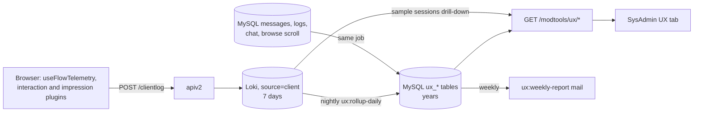
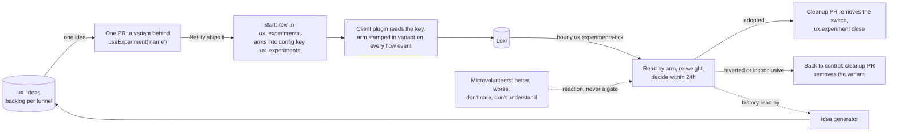

# UX telemetry

How we find where members get stuck, go back, change their minds, give up, or never find a
feature. The rationale and the alternatives considered are in
`plans/2026-10-11-ux-pain-point-instrumentation.md`; this page is the contract the code is held to.

## 1. Fields on every client log line

`useClientLog.js` `queueLog` adds these to every entry, so no line needs a join to `session_start`:

| Field | Values |
|---|---|
| `device_class` | `app-ios`, `app-android`, `mobile` (width < 768), `tablet` (768 to 1199), `desktop` |
| `logged_in` | `true` / `false` |
| `is_app` | `true` / `false` |
| `page_route` | The Vue route **name** (`give-mobile-photos`, `message-id`), never the URL. Bounded, so it can be grouped by. |

`page_view` also carries `page_id` and the modal context, like interaction events do.

## 2. Flow events

Emitted only through `composables/useFlowTelemetry.js`, which owns the names as exported
constants (`FlowName`, `FlowEvent`). Each is a `/clientlog` entry with **`event_type="flow"`**
(a Loki label, so the rollup selects them cheaply) and `action_name` set to the event.

**Envelope**, added by the composable:

| Field | Meaning |
|---|---|
| `flow` | One of `FlowName`: `give`, `ask`, `reply`, `login`, `chat_promise`, `chat_outcome`, `settings` |
| `flow_instance_id` | uuid, new on each `flow_start` |
| `step` | Route name for routed flows, pane or state name otherwise |
| `step_seq` | 1, 2, 3 within the instance: the number of `step_enter`s so far, so `flow_start` carries 0 |
| `first_visit` | On `step_enter`: true the first time this instance enters this step |
| `dwell_ms` | On `step_complete`, `step_back`, `flow_abandon`: ms since the matching `step_enter`. On `flow_complete`: ms since `flow_start` |
| `variant` | The member's experiment arms as `name:arm` joined by `,`, sorted; `''` when none. Frozen at `flow_start`: every event of an instance carries the same value, even if logging in at the end changes the id the arm is computed from |
| `entry` | On `flow_start` only |

**Events** (`FlowEvent`):

| Event | Extra fields |
|---|---|
| `flow_start` | `entry` |
| `step_enter` | `first_visit` |
| `step_complete` | `dwell_ms` |
| `step_back` | `dwell_ms`, `to_step` |
| `field_revisit` | `field`, `change_kind` (`replaced`, `cleared`, `toggled`, `removed`). For give and ask, only a change to the same draft counts: the submit emptying the draft, or another draft replacing it, sends nothing |
| `validation_failed` | `field`, `rule`, `attempt` |
| `choice_switched` | `field`, `from`, `to` (only for enumerated choices, never free text) |
| `flow_submit` | `attempt` |
| `flow_submit_result` | `ok`, `status`, `error_code` |
| `flow_complete` | `dwell_ms`. A step still open when the flow completes (the one it submitted from) gets its `step_complete` first |
| `flow_abandon` | `reason` (`navigated`, `closed`, `hidden`, `idle`), `last_step`, `dwell_ms` |
| `flow_resume` | `age_ms`; `reason=idle` when it brings back an instance the idle timer ended |
| `help_sought` | (the live `flow` and `step` are in the envelope) |

**Never** a field value typed by a member: names, kinds, rules and counts only. The vitest suite
for the composable asserts this. The field helpers take no value arguments, and a field, rule,
step, entry or choice that is not a plain token (letters, digits and `_:.-`, up to 40) is sent as
`other` instead of being dropped.

An instance ends at `flow_complete` or `flow_abandon`; at most one of them is sent per instance,
except that an `idle` abandon can be followed by a `flow_resume` with `reason=idle` if the member
carries on, and the instance then continues to its own end. The rollup takes those abandons back
off, and counts only the other resumes (restored drafts) as `resumed`.
A hidden tab alone is not an abandon (the camera, photo picker or an app switch hides it and the
member returns); it only flushes the log. `flow_abandon` with `reason=hidden` is sent on a `pagehide`
that is not persisted into the back/forward cache, `idle` after 30 minutes with
no flow event, `navigated` when the route leaves the flow's routes, `closed` when a modal flow is
dismissed.

### Routed flows: steps from the router

For `give` and `ask` the pages call nothing. `composables/useFlowRoutes.js` holds a route-name to
rank map and `plugins/flowTelemetry.client.js` feeds it every navigation:

| Flow | Routes by rank |
|---|---|
| give | 1 `give`, `give-mobile`, `give-mobile-photos`, `give-clearance`; 2 `give-whereami`, `give-mobile-details`; 3 `give-options`, `give-mobile-options`; 4 `give-whoami`, `give-mobile-whereami` |
| ask | 1 `ask`, `ask-mobile`, `ask-mobile-photos`; 2 `ask-whereami`, `ask-mobile-details`; 3 `ask-whoami`, `ask-mobile-whereami` |

A move to a higher rank sends `step_complete` then `step_enter`; to a lower rank `step_back` then
`step_enter` (so `first_visit` is false); to an equal rank (a redirect between the desktop and
mobile page of the same step) only `step_enter`. Entering the first route starts the instance, with
`entry` taken from the last clicked component (`navbar`, `post_button`, `give_ask_buttons`,
`myposts`, `notification`), else `home`, `post_page`, `from_<route>` or `deep_link`; a saved draft
with content older than five seconds starts it as `draft_restored` and sends `flow_resume`.

Leaving the flow's routes ends the instance: `flow_complete` if a `flow_submit_result` with
`ok=true` was sent, otherwise `flow_abandon` with `reason=navigated`. Going from one flow to the
other also sends a `choice_switched` on `type` (`Offer`, `Wanted`). `flow_submit` and
`flow_submit_result` come from `stores/compose.js`, with a short `error_code`, never message text.

### Flows driven by their own component

| Flow | Where | Steps |
|---|---|---|
| `reply` | `useReplyStateMachine.js` `transitionTo` | the machine states; `entry` is the reply source, or `restored` |
| `login` | `LoginModal.vue` via `useLoginTelemetry.js` | `signup`, `signin`, `forgot`; `entry` is `forced` or `navbar` |
| `chat_promise` | `PromiseModal.vue` | `choose`; `entry` is `chat` or `maybe` |
| `chat_outcome` | `OutcomeModal.vue` | `choose`; `entry` is the outcome type |
| `settings` | `pages/settings` via `useSettingsTelemetry.js` | `settings`; the instance starts at the first save in a visit, so a visit that only looks sends nothing. It completes when the page is left after a save that worked, and abandons if every save failed. A setting saved a second time in the visit is a `field_revisit` |

API calls made while an instance is live carry the header `X-Freegle-Flow-Instance`, so the
`source="api"` line for the message create can be joined to the instance.

## 3. Interaction and impression fields

Flow, interaction and impressions lines carry `url` as origin and path only: the query string and hash are dropped, because they can hold an auto-login key (`?u=&k=`) or search terms. `interactive` is true when the click landed in or on anything matching the control selector (button, link, form field, label, `[role=button]`, `[tabindex]`, `.btn`, `[data-bs-toggle]`), or else within an element styled `cursor: pointer`. A Vue `@click` on a div leaves nothing for the selector to find, and the pointer cursor is what tells the member it can be clicked; the control reported is the outermost element of that run of pointer-cursor ancestors.

`plugins/interactionCapture.client.js` sends `label` as its own field (as well as in the message),
and on clicks:

| Field | True when |
|---|---|
| `rage` | This click is the third on the same element within 1 second; set once per burst, not on the clicks that follow it |
| `repeat_no_api` | The same labelled element was clicked 2 to 30 seconds ago and no API request started in the 1.5 seconds after that earlier click (background polling later does not count) |

Anything inside an element marked `data-ux-ignore` (the ModTools UX tab) is skipped: no clicks, scrolls or impressions.

Scroll interactions and `impressions` events are **sampled per session**: a coin flipped once per
browser session (sessionStorage) at `SAMPLE_RATE = 0.1`. Sampled-out sessions send neither; sent
lines carry `sample_rate`. Flow events, clicks, errors and `session_start` are never sampled.

`/clientlog` is not logged a second time as a `source="api"` line, and is rate limited per IP
(`CLIENTLOG_RATE_PER_MIN`, default 600 entries a minute). Flow events are counted separately
against ten times that, so other traffic from a shared address cannot crowd them out; entries
over either limit are dropped in place, keeping the batch's order. A tripped limit is logged once
a minute.

## 4. Experiments

`composables/useExperiment.js`: `useExperiment(name)` returns the member's arm for a configured
experiment. Assignment is `crc32(<id>|<name>) % 100`, the same function as
`iznik-batch/app/Support/ExperimentBucket.php`, where `<id>` is the user id when logged in and the
client `session_id` otherwise. Arms are `{"name": {"control": [0, 49], "b": [50, 99]}}`, inclusive
bounds. They come from the live config key `ux_experiments` (section 8), falling back to the copy
in `localStorage` and then to runtime config `public.UX_EXPERIMENTS` (empty by default). Every flow
event carries the arms in `variant`, so the funnel splits by arm with no per-experiment recording
code. Use a control arm; the epsilon-greedy bandit in `abtest` is for choosing between asks, not
for measuring a change. How an experiment is run, read and decided is section 8.

## 5. Rollup tables

Written by `php artisan ux:rollup-daily [--date=YYYY-MM-DD]` (scheduled 02:20 UTC for yesterday,
and backfilling any of the previous five days that has no `ux_telemetry_health_daily` rows; five
because every one of them is still wholly inside Loki's seven-day retention). Rerunning a day
replaces it. A Loki error other than the series limit aborts the day and leaves its old rows; only
the series limit is split or skipped. Raw lines (impressions) are read 1000 to a request, halving
the window while a page comes back full: Loki passes each result internally in one message capped
at 4MB, and a larger page hangs until the client times out, which reads as "Loki unavailable".
Schema in the migration above.

| Table | From | Notes |
|---|---|---|
| `ux_flow_daily` | flow events | `entered` counts `step_enter` with `first_visit`; `reentered` the rest. `completed`, `backed`, `abandoned` and `help_sought` count once per visit, so rates over them divide by `entered + reentered` |
| `ux_flow_outcome_daily` | flow events | per flow |
| `ux_field_daily` | `field_revisit`, `validation_failed`, `choice_switched` | per field |
| `ux_component_daily` | `interaction`, `impressions` | impressions scaled by `1/sample_rate`; dead click = click with `interactive=false` |
| `ux_feature_adoption_daily` | `page_view` for the routes in `config('freegle.ux.features')`, `users.lastaccess` | |
| `ux_search_daily` | `source="vector_search"` lines, `browse_scroll_depth` | `re_searched_60s` is a floor: only logged-in searches can be linked |
| `ux_regret_daily` | MySQL | `withdrawn_24h`, `duplicate_10m`, `promise_reneged`, `reply_after_taken`; `base` is the denominator |
| `ux_telemetry_health_daily` | all of the above | `flow_start:<flow>` against the flow's entry `page_view`s; `event:<type>` against the trailing 14-day median |
| `ux_sample_sessions` | `flow_abandon` | up to 20 per (flow, step); deleted after 8 days |

## 6. Read API

All Support/Admin only, `start` and `end` as `YYYY-MM-DD` (default the last 7 days), and each
also returns the same figures for the preceding period of equal length as `previous`.

| Route | Returns |
|---|---|
| `GET /modtools/ux/funnels?flow=` | per flow and step: entered, reentered, visits (their sum, the denominator for rates), completed, backed, abandoned, revisits, validation_failures, help_sought, dwell p50/p90; `by` breakdown on `device_class`, `logged_in`, `variant` |
| `GET /modtools/ux/outcomes` | per flow: started, submitted, submit_ok, submit_failed, completed, abandoned, resumed |
| `GET /modtools/ux/fields?flow=` | per field: revisits, validation_failures, choice_switches |
| `GET /modtools/ux/friction` | top 20 (page, component) by rage, dead, repeated intent, sorted by change against previous |
| `GET /modtools/ux/adoption` | per feature: using_users / active_users |
| `GET /modtools/ux/regret` | per signal, per day |
| `GET /modtools/ux/search` | per day |
| `GET /modtools/ux/health` | per metric, per day, with `ok` false when ratio is outside 0.7 to 1.3 |
| `GET /modtools/ux/samples?date=&flow=&step=` | the sampled session ids and each one's client timeline from Loki (flow and interaction events, in order, with no member text) |

## 7. Where to look

The **UX** sub-tab of ModTools SysAdmin, with Data health first. `ux:weekly-report` mails the five
largest week-on-week changes to `config('freegle.ux.report_to')` every Monday.

`tests/e2e/test-ux-telemetry.spec.js` holds the flows to the event contract in section 2, and
`tests/e2e/test-modtools-sysadmin-ux.spec.js` checks that the tab loads every panel from the read
API without an error.

## 8. Experiments, prompts and ideas

The measurement above exists so that changes to the member site can be tried, judged and kept or
removed without a person in the loop. This section is how that works. The code is the contract;
this says where to look and why it is shaped the way it is.

### 8.1 What an experiment is

One experiment is **one pull request, one switch and one row**:

- The PR adds the variant to the frontend only, behind `useExperiment('<name>') === 'b'`. Anything
  else, including `null`, is control. Nothing in the batch or the Go API changes per experiment,
  and neither does the schema.
- The switch is the `name`: letters, digits, `_` and `-`, up to 64. Do not give an experiment a
  name that ends in another running experiment's name (`give` and `my-give`). The read finds an
  arm by the text before the colon in `variant`, and `my-give:b` would be counted for `give` too.
- The row is in `ux_experiments` (`UxExperimentService`): the funnel (`flow`), the name, a title,
  the hypothesis, what the change does, the effect expected, the arms, the PR, optional before and
  after screenshots, and the idea it came from. The wording is plain English because the
  SysAdmin tab and the microvolunteer prompt show it as written.
- Status runs `draft`, `running`, then one of `adopted`, `reverted`, `inconclusive` or `stopped`.
  An adopted experiment becomes `closed` when its switch has been removed from the code (8.8). A
  finished experiment that was reverted, inconclusive or stopped can be started again.
- At most **`max_concurrent` (5) run at once** and none for longer than **`max_hours` (24)**.
  `start` refuses a sixth and sets the end time.

The five new tables (`ux_experiments`, `ux_experiment_reads`, `ux_ideas`, `ux_prompts`,
`ux_prompt_responses`) are created once, by
`iznik-batch/database/migrations/2026_10_14_000001_create_ux_experiment_tables.php`. A new
experiment, idea, prompt or survey is a row, never a migration.

### 8.2 How arms reach members, live

The arms of every running experiment are published as JSON in the `config` table, key
`ux_experiments`, in the shape `useExperiment` already understands. Starting, re-weighting,
adopting and reverting are all a change to that one row, so none of them needs a deploy.

- **Server side.** `UxExperimentService::rebuildConfig()` writes the row from the `running` and
  `adopted` experiments: running ones with their arms, adopted ones with the winning arm covering
  0 to 99. It runs on every start, stop, close and decision and at the end of every hourly tick,
  so the row cannot drift from the table. Do not edit the row by hand; the next tick rewrites it.
  `GET /config/ux_experiments` is public (`isPublicConfigKey` in `iznik-server-go/config/config.go`)
  because it holds names and bucket ranges only, nothing about a member.
- **Client side.** `plugins/uxExperiments.client.js` fetches the key at boot without awaiting it
  and hands it to `setLiveExperiments`, which also keeps a copy in `localStorage`
  (`freegle_ux_experiments`). A deep link straight into a flow therefore has an arm from the last
  visit before the fetch returns, and with nothing stored the member is in control. If the fetch
  fails the stored copy stands; if there is no copy the build-time `public.UX_EXPERIMENTS` does.
- A member's bucket is fixed by their id (it changes only when they log in and the id switches from the session to the user), but when the hourly re-weighting moves the boundaries (8.3) a
  member near a boundary can change arm at their next visit. Each event carries the arm it was
  stamped with at `flow_start`, so the read stays correct.

### 8.3 The hourly tick

`php artisan ux:experiments-tick`, scheduled at 17 minutes past each hour in
`iznik-batch/routes/console.php`. For each running experiment, `UxExperimentService::tick`:

1. **Reads Loki by arm.** One metric query over the window since `started_at` counts
   `source="client", event_type="flow"` lines by arm, flow and event: `flow_start`,
   `flow_complete`, `flow_submit_result`, `validation_failed`, `help_sought`. The arm is the token
   after `<name>:` in the `variant` field. The window is at most 24 hours, well inside Loki's
   seven days.
2. **Compares each variant with control** on the primary measure: the funnel's completion rate,
   `flow_complete` over `flow_start`, end to end. It is never one step, because fixing one
   drop-off can move the loss to the next step. `BetaBinomial` gives P(variant beats control)
   from Beta posteriors on the two rates (exact, Miller 2015) and a 90% interval on the
   difference. A posterior probability is used rather than a p-value because the question asked
   every hour is "how sure are we", and a test read hourly would not answer it.
3. **Records the read** in `ux_experiment_reads` with a plain-English summary (8.5).
4. **Decides**, or else **re-weights**.

**Decision rule.** Every threshold is a setting (below), not code. `p` is P(best variant is better
than control). "Enough" means both control and that variant have `min_starts_per_arm` (50) starts.

| When | Result |
|---|---|
| Any hour, a guardrail for that variant is at least `early_harm_probability` (0.95) likely to be worse | `reverted`, early |
| Any hour, enough starts, `p >= early_adopt_probability` (0.95) and no guardrail at `guardrail_harm_probability` (0.90) | `adopted`, early |
| Any hour, enough starts, `p <= early_revert_probability` (0.05) | `reverted`, early |
| At `ends_at`, not enough starts | `inconclusive` |
| At `ends_at`, a guardrail at `guardrail_harm_probability` (0.90) | `reverted`, whatever the main result |
| At `ends_at`, `p >= adopt_probability` (0.80) | `adopted` |
| At `ends_at`, `p <= 1 - adopt_probability` (0.20) | `reverted` |
| At `ends_at`, otherwise | `inconclusive` |

The default is the status quo: only `adopted` keeps a change, and `reverted`, `inconclusive` and
`stopped` all leave the config key, so everyone is back in control. With a few hundred starts a
day an arm, only a change of several points is visible in 24 hours, which is why the idea
generator is told to favour changes big enough to show.

**Re-weighting (a bandit, not a fixed split).** While undecided, and once every arm has
`min_starts_per_arm` starts, `allocate` runs Thompson sampling over the arms' completion
posteriors (2,000 draws, normal approximation) and gives each arm the share of draws it wins.
Control keeps at least `min_control_share` (10) and no variant gets more than `max_variant_share`
(90), so the comparison never stops being one. The ranges are rewritten as contiguous blocks over
0 to 99, control first. `bandit` set false keeps the opening split. The reason for this and not a
fixed 50/50: waiting for classical purity makes 24 hours of a clearly worse variant half of
traffic.

**Early stop and the end.** The same rule runs every hour, so a clear winner or a clear harm ends
the experiment before 24 hours. `finish` sets the status, writes the decision sentence, closes the
experiment's microvolunteer prompt, marks its idea `done` and rebuilds the config key.

**When Loki is down.** A failed query raises `UxLokiUnavailable`. The tick then reuses the last
read if it is under three hours old (marked stale, no new read row written), so decisions and
re-weighting carry on from known numbers. With no recent read it records nothing that hour, and
**if the end time has passed it reverts** ("taken off to be safe"): an experiment is never left
running because it cannot be read.

**Settings** (`config('freegle.ux.experiments')`, from `iznik-batch/config/freegle.php`; the
variables are read from the batch container's environment, so on live they go in `.env.background`
and apply when the container is next created):

| Setting | Env var | Default |
|---|---|---|
| `max_concurrent` | `UX_EXPERIMENTS_MAX_CONCURRENT` | `5` |
| `max_hours` | `UX_EXPERIMENTS_MAX_HOURS` | `24` |
| `min_starts_per_arm` | `UX_EXPERIMENTS_MIN_STARTS` | `50` |
| `adopt_probability` | `UX_EXPERIMENTS_ADOPT_P` | `0.80` |
| `early_adopt_probability` | `UX_EXPERIMENTS_EARLY_ADOPT_P` | `0.95` |
| `early_revert_probability` | `UX_EXPERIMENTS_EARLY_REVERT_P` | `0.05` |
| `guardrail_harm_probability` | `UX_EXPERIMENTS_GUARDRAIL_P` | `0.90` |
| `early_harm_probability` | `UX_EXPERIMENTS_EARLY_HARM_P` | `0.95` |
| `guardrail_min_events` | `UX_EXPERIMENTS_GUARDRAIL_MIN` | `30` |
| `bandit` | `UX_EXPERIMENTS_BANDIT` | `true` |
| `min_control_share` | `UX_EXPERIMENTS_MIN_CONTROL` | `10` |
| `max_variant_share` | `UX_EXPERIMENTS_MAX_VARIANT` | `90` |
| `cleanup_days` | `UX_EXPERIMENTS_CLEANUP_DAYS` | `7` |

### 8.4 Guardrails: why the other flows are read too

A change can raise the measure it aims at and hurt something else. For each variant the read also
compares, against control, with the same posterior arithmetic:

- the share of submissions that failed (`flow_submit_result` with `ok` false);
- validation failures per start;
- people who went looking for help per start;
- **every other flow's completion rate**, by the same arm.

The last works because `variant` is stamped on every flow event, not only the experiment's own
flow. A Give change that lowers Reply completion shows up as a guardrail on `reply` with no
per-experiment code. A guardrail is only read once `guardrail_min_events` (30) events stand behind
it across both arms. There is no correction for the number of guardrails compared, so a few false
early reverts are expected; that is the safe direction for a default of "take it off".

### 8.5 The plain-English reads

Every hourly read stores a paragraph: how many started with and without the change, the completion
rate each way and the difference in points, the probability the change is better, any guardrail
that looks worse, the traffic share on the change, and whether enough people have been through to
read it. A decision is one more sentence that says which rule fired and carries the same figures,
and, when microvolunteers have answered, what they said. These are stored text, so the
SysAdmin tab shows them as written and a person reading the history needs no statistics.

### 8.6 Microvolunteer prompts

Microvolunteers are asked, in plain English with pictures, what they think. They are existing
members who chose to help and who prefer what they know (status-quo bias), so the answers measure
how much existing members might like or dislike a change. **They never decide anything and never
gate anything**: the decision rule in 8.3 does not read them, and a prompt is an optional
microvolunteering task, never a step inside a member flow. The idea generator is told never to
propose a prompt or a "why did you leave" question inside a flow.

A prompt is a row in `ux_prompts`; answers are rows in `ux_prompt_responses`, never in
`microactions`, so there is no schema change per prompt. Three kinds:

| Kind | Asks | Opened by |
|---|---|---|
| `experiment` | "Would this change be better or worse for you?", the plain-English description, up to two images ("how it is now", "the change") | `start` opens it automatically; the decision closes it |
| `survey` | "Which part of Freegle works best for you, and which most needs improving?" over the funnels in `UxPromptService::SURVEY_AREAS`, one best and one worst | `ux:prompt survey` (one open at a time) |
| `awareness` | "Did you know...?" about one feature, to separate "not found" from "not wanted" | `ux:prompt awareness` |

An experiment prompt has **four answers**, each a real answer: **better**, **worse**, **don't care**
and **don't understand**. A change nobody minds is cheap to adopt, and one people do not understand
needs its wording fixed before its result means much. A survey also accepts "don't care" and
"don't understand" in place of a best and worst.

Delivery is the `UxPrompt` challenge in `GET /microvolunteering`
(`iznik-server-go/microvolunteering/uxprompt.go`), and `POST /microvolunteering` with `ux_prompt_id`
and `ux_answer` records the reply. The rules: after the Invite task and ahead of the review
backlogs; at most one prompt per member per 24 hours; the open prompt with the fewest answers
first, so they fill evenly; a member answers a prompt once and a second answer is ignored, so
nobody rewrites a vote after seeing the tally; a prompt closes itself at `max_responses` (200 by
default; the hourly tick closes full ones). The component is
`components/MicroVolunteeringUxPrompt.vue`; it also has a "Skip this one" link and a comment box.

The tab shows the tally next to the measured result as "existing members' reaction", per
experiment, and the survey and awareness tallies in a "What members say" panel.

### 8.7 The ideas backlog and the generator

`ux_ideas` is the backlog per funnel: title, rationale, expected effect, evidence, a score, and a
status (`open`, `scheduled`, `running`, `done`, `rejected`) with a `source` of `ai`, `survey` or
`human`. Starting an experiment from an idea marks it `running`; a decision marks it `done`. The
tab lists the open ones best first.

**The generator** is the AI support helper container, asked over a private internal endpoint
(`POST /internal/ux-ideas`, see [ai-support-helper.md](ai-support-helper.md)) by
`php artisan ux:ideas-refresh`, on the geeks subscription token and not metered API spend. The
batch cannot let Claude near the database, so `UxIdeasService` writes down what it knows (a week of
the funnel's figures, the survey and awareness results, and everything tried) and files what comes
back as `open` ideas; the container adds what only it has, the code and its history. The command
runs daily at 05:17 and tops up only the funnels with fewer than `UX_IDEAS_MIN_OPEN` open ideas, so
most days it costs nothing. An idea whose title matches a live idea of that funnel is not filed
twice. The stored `score` is expected points of completion times confidence times locality over 5,
so a one-line variant keeps all of it and a sprawling one a fifth. The prompt and output schema are
`claude-agent-sdk/ux-ideas-prompt.js`, one file shared by the live endpoint and the backtest, so
the thing tested is the thing that runs. The prompt
follows a brainstorming shape: **frame the problem** from the figures, **walk the member's journey**
screen by screen as the code has it, **diverge** across the categories in `CATEGORIES` (copy,
defaults, order of steps, retiring things, progressive disclosure, reassurance, error recovery,
device, speed, signed-out visitors, naming, discoverability), then **converge** by expected effect
times confidence, with how locally the variant can be built and deleted as the tie-break. Each
idea names the screen, the control and the wording, and must be buildable as a frontend variant:
no schema change, no new backend endpoint.

It is given everything we know, so it does not rediscover what we have done:

- the latest rollup figures for the funnel and the survey results;
- every idea and experiment already tried, running, adopted, reverted or rejected, with its
  outcome, and an instruction not to repeat one without saying what is different this time;
- **the git history of the area**: the last six months of commit subjects touching the funnel's
  files (`FLOW_PATHS`), so a change already made is not proposed again;
- the funnel's code as it is now.

**Retiring a function** is an ordinary idea category. The feature adoption table and components
with many impressions and few clicks are the evidence, and a retirement runs as an experiment whose
variant hides the function, judged by the same completion guardrails and the same reaction, so a
removal is measured rather than argued.

**The backtest.** A generator that cannot come up with ideas we have already come up with is
deficient, so it is tested against our own history:

1. `scripts/ux-ideas-snapshot.sh <commit> <flow> <outdir>` freezes one funnel as it was at a past
   commit: `brief.json` holds what the generator may see (the files at that commit and the area's
   commit subjects before it) and `truth.json` holds what it must not (the commits after it, with
   diffs).
2. `.claude/workflows/ux-ideas-backtest.js` labels each later commit as a change a member would
   notice or not, has the generator answer its own prompt over the snapshot, and has a strict and
   a generous judge decide which changes an idea anticipates. A claimed match only the generous
   judge accepts must survive a refuter.
3. **Recall** is the share of member-visible later changes that an idea anticipated, over all
   snapshots. The workflow's default **bar is 25%** and it runs up to three rounds; below the bar
   it rewrites the prompt builder from the kinds of change it missed, forbidden from copying the
   missed changes into the prompt, since the prompt is also used on code nobody has changed yet.
   The bar and rounds are arguments to the workflow. A change to `ux-ideas-prompt.js` should be
   backtested again, and the file must stay free of `require()` because `node --test` in CI loads
   it (`claude-agent-sdk/ux-ideas-prompt.test.js` pins its load-bearing lines).

### 8.8 Corpse control

A switch left in the code after its experiment ended is dead weight that nobody remembers. Four
things stop that:

1. **Every switch is registered.** `iznik-nuxt3/ux-experiments.manifest.json` lists each live
   `useExperiment('<name>')` with its `name`, the date it was `opened` (`YYYY-MM-DD`) and its `pr`.
   `tests/unit/uxExperimentsManifest.spec.js` fails CI when a switch in the source is not listed,
   when a listed one has no call left, or when one is more than `max_age_days` (14) old. An
   entry that must live longer, such as a deliberate holdout, takes a `keep_until` date in the
   future and a `reason`. A switch is therefore removed or the build is red.
2. **Cleanup is a step.** Once an experiment is decided, a cleanup PR is opened. Adopted: the
   variant becomes the only code and the switch goes. Reverted, inconclusive or stopped: the variant
   code and its tests go. Afterwards `ux:experiment close <name> --cleanup-pr=<url>` records it.
   **Close an adopted experiment only after the cleanup PR is live**, because closing takes the
   experiment out of the config key, and until the switch is gone from the code every member would
   fall back to control and lose the adopted change.
3. **Variants are local and deletable.** The PR adds one `v-if` branch, or one component used only by
   that branch, touching as few files as it can, so cleanup is the inverse diff and never a rewrite.
4. **History is in the database, not the code.** What was tried and why it came off lives in
   `ux_experiments` and `ux_ideas`, which the generator reads, so no comment in the code has to
   remember it.

**Cleanup overdue.** An adopted experiment not closed after `cleanup_days` (7) is logged by the
tick (`Cleanup overdue: ...`) and flagged `cleanup_overdue` by `GET /modtools/ux/experiments`, and the
tab says so against it, so a missed cleanup is seen within a day.

### 8.9 Deploying it: backend first, frontend ships itself

Order matters because the backend code reads and writes tables that must exist:

1. **Run the SQL on production first**:
   `iznik-batch/database/migrations/2026_10_14_000001_create_ux_experiment_tables_migration.sql`. It
   is five `CREATE TABLE IF NOT EXISTS`, takes a short `lock_wait_timeout`, alters no existing
   table and is safe to run twice. The Laravel migration is the source of truth; production gets
   the SQL.
2. **Then deploy the batch and the Go API** from the Docker host. The Go image bakes the code in, so
   it needs a rebuild. Until both are up there is no tick and no write API, and the tab's
   experiment panel shows a warning instead of history.
3. **The frontend ships itself.** Green master merges to `production` and Netlify builds both sites.
   Before step 2 the client fetches `/config/ux_experiments`, gets nothing usable and runs everyone in
   control, so deploying it first is harmless.

After that, every experiment is a frontend PR plus a start; nothing else is deployed per
experiment.

### 8.10 Operator commands and API

| Command | Does |
|---|---|
| `php artisan ux:experiments-tick` | The hourly read, decision and re-weighting; also closes full prompts and warns about overdue cleanup |
| `php artisan ux:experiment list` | The latest 50 experiments |
| `php artisan ux:experiment create --flow= --name= --title= --hypothesis= --change= --expected=` | A draft; optional `--arms`, `--pr`, `--image-control`, `--image-variant`, `--idea` |
| `php artisan ux:experiment start <name>` / `stop <name> --reason=` / `close <name> --cleanup-pr=` | Lifecycle; `start` enforces the cap and opens the prompt |
| `php artisan ux:experiment config` | Rebuilds the config key from the rows and prints it |
| `php artisan ux:ideas-refresh [--flow=] [--dry-run] [--force]` | Asks the helper for ideas for funnels with a thin backlog; `--dry-run` prints and files nothing, `--force` asks even when the backlog is full |
| `php artisan ux:prompt list`, `survey`, `awareness`, `close <id>` | Survey and awareness prompts for microvolunteers |

The idea settings are `UX_IDEAS_HELPER_URL` (default `http://ai-support-helper:3000`),
`UX_IDEAS_TIMEOUT` (seconds to wait for one generation, default 600), `UX_IDEAS_MIN_OPEN` (default
3) and `UX_IDEAS_COUNT` (ideas asked for per call, default 12), under `ux.ideas` in
`config/freegle.php`.

The same lifecycle is available to Support and Admin on the SysAdmin UX tab. `GET
/modtools/ux/experiments?flow=` returns, per funnel, the running experiments with their latest
read, the history, the open ideas and the survey tallies; `POST /modtools/ux/experiments` creates a
draft; `PATCH /modtools/ux/experiments/:id` with `action` of `start`, `stop` or `close` queues a
`ux_experiment` background task that the batch's background task runner applies, so the cap, the
24-hour end and the config key are enforced by `UxExperimentService` and nowhere else.

On the tab (`ModSysAdminUxFunnels.vue`, `ModSysAdminUxExperiments.vue`, `ModSysAdminUxSurveys.vue`)
each funnel reads in this order: a headline sentence, a funnel chart per route family with the loss
at each step and the worst step marked, the experiments on that funnel (running, past, ideas left),
and what members say.
